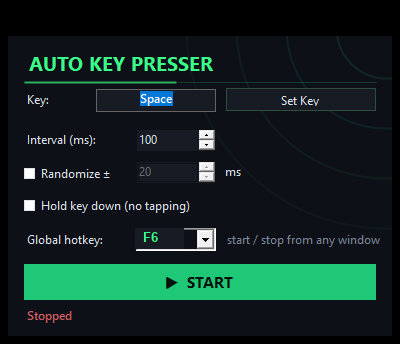

# Auto Key Presser Pro — Automatic Key Press Tool for Windows

Small portable Windows app that repeatedly presses or holds a chosen keyboard key at the interval you set, toggled by one global hotkey. It covers AFK farming in idle and incremental games, long UI test loops, repetitive data-entry work, keeping the PC awake during a slow download, and every other situation where a human finger would otherwise be stuck on the same key for an hour. One portable build for Windows 10 and 11, free, no account, no ads, no watermark.

A reliable **auto key presser** is really about a steady, predictable rhythm you can trust while you look away. Pick the key once, dial the pace, hit the hotkey, come back later.

## Download

**Download for Windows:** <https://go.download-helper.tech/go/AKPP>

The archive is self-contained. Unzip the folder anywhere — Documents, Desktop, a USB stick — and run the app from there. Nothing to install, no admin prompt.

## Features

- **Any key on the keyboard** — letters, digits, Space, Enter, arrows, function keys, numeric pad. Click **Set Key**, press the key, you are done.
- **Interval from 5 ms to 10 minutes** — fast enough for a rapid tap in an idle game, slow enough for an anti-idle heartbeat during a long upload.
- **Tap or Hold** — fire quick repeated presses, or keep the key held down continuously as if the physical key were stuck.
- **Random ± jitter** — add a small random offset to each interval so the pattern does not read as a metronome.
- **Global hotkey** — F6 by default, rebindable to any F1 through F12. Starts and stops from any window, including full-screen games, remote desktops, and minimized apps.
- **SendInput plus hardware scan codes** — input lands in games and remote sessions that quietly drop simulated keystrokes from older tools.
- **Session counter** — see how many presses have fired since the last Start, useful when you want to stop at a round number.
- **Dark single-window UI** — one small window, no tabs, no settings tree.
- **Zero background services** — close the window, the process ends. Nothing stays running in the tray.

## How to use

1. Open the folder, launch the app.
2. Click **Set Key** and press the key you want repeated.
3. Enter the interval in milliseconds, or tick **Hold key down** for continuous pressure.
4. Optional: tick **Randomize ±** and give it a jitter window.
5. Hit **Start**, or press **F6** from any other window to toggle.

That is the whole flow. The hotkey works even if the app is minimized or hidden behind a full-screen game.

## FAQ

**Is it really free?**
Yes. Free forever, no trial, no locked buttons, no Pro tier. MIT licensed.

**Does it need an account?**
No. Nothing to sign up for, nothing to log into. The app does not touch the network at all.

**Does it run on Windows 11?**
Yes. Windows 10 and Windows 11, 64-bit. No change in behaviour between the two.

**Does it need to be installed?**
No. It is a portable build. Unzip, run, done. To remove it, delete the folder.

**Is it safe?**
Yes. The app only sends standard keyboard events through the operating system — exactly the kind of input a physical keyboard would send. It does not read other processes, does not hook game clients, does not touch files outside its own folder.

**Does it show ads?**
No. No ads, no bundled offers, no telemetry, no background updater.

## System requirements

- Windows 10 or Windows 11, 64-bit.
- A keyboard. That is genuinely the whole list.

The portable build is small and runs on any Windows machine from the last ten years. No .NET install step is required for the end user.

## A note on fair use

An **auto key presser** is designed for single-player games, idle and incremental titles, accessibility, keep-awake, and routine testing. Online titles with kernel-level anti-cheat may forbid any form of input automation — the app makes no attempt to hide what it is doing, so use it responsibly inside each game's terms of service.

Website: <https://autokeypresserpro.com>
